 

---

## 👨‍💻 About Me

Hello! I'm Hanamariam Sebsbew, a Software Engineering student at Wollo University with a strong interest in full-stack development and software engineering.

I enjoy transforming ideas into practical software solutions, exploring new technologies, and collaborating on projects that solve real-world problems.

- 💻 Interested in full-stack application development.
- 🚀 Building projects to strengthen my practical programming skills.
- 🧠 Improving my problem-solving and data structure knowledge.
- 🤝 Enjoy collaborating and working with development teams.
- 🌱 Continuously learning and growing as a developer.

Current focus: Strengthening my backend and frontend development skills while improving my software engineering foundations.

---

## 🛠️ Technology Stack

### Programming Languages

### Frontend Development

### Backend Development

### Database & Development Tools

### Core Computer Science & Engineering

---

## 🚀 Featured Projects

<table>
<tr>
<td width="50%" valign="top">

<h3>🚌 Swift-Bus</h3>

A collaborative transport reservation and ticketing management system designed to organize bus booking and transport operations.

<a href="https://github.com/hanamariam1dev/swift-bus"><b>View Project →</b></a>

</td>

<td width="50%" valign="top">

<h3>🎓 Student Dropout Prediction</h3>

A machine learning classification project that predicts student dropout risks using academic and behavioral data.

<a href="https://github.com/hanamariam1dev/Student-Dropout-Prediction"><b>View Project →</b></a>

</td>
</tr>

<tr>
<td width="50%" valign="top">

<h3>🏦 Banking System Java GUI</h3>

A desktop banking application with a graphical user interface for managing accounts and banking transactions.

<a href="https://github.com/hanamariam1dev/Banking-System-Java-GUI"><b>View Project →</b></a>

</td>

<td width="50%" valign="top">

<h3>💡 What I'm Exploring</h3>

Developing stronger practical skills in full-stack application development, software architecture, databases, and collaborative software projects.

</td>
</tr>
</table>

---

## 📊 GitHub Analytics

  

---

## 🐍 Contribution Activity

<i>Every contribution represents another step in the journey of learning and building.</i>

<picture>
  <source media="(prefers-color-scheme: dark)"
    srcset="https://raw.githubusercontent.com/hanamariam1dev/hanamariam1dev/output/github-contribution-grid-snake-dark.svg">

  <source media="(prefers-color-scheme: light)"
    srcset="https://raw.githubusercontent.com/hanamariam1dev/hanamariam1dev/output/github-contribution-grid-snake.svg">

  
</picture>

---

## 🤝 Let's Connect

I'm interested in connecting with developers, learning from others, and collaborating on meaningful software projects.

---

### Building Today. Improving Tomorrow.

<i>"Great software is built through curiosity, consistency, and continuous learning."</i>

 

